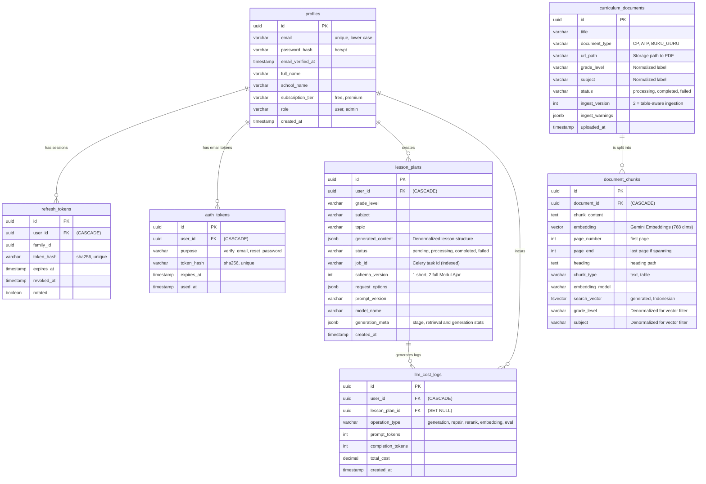

# Database

The schema of the SARPEBE backend. The database is **PostgreSQL (hosted on Supabase; 17 is in use)** with the **pgvector** extension (0.8 or newer recommended for filtered HNSW search) and the built-in Indonesian text-search configuration. Schema changes are made only through Alembic migrations in `sarpebe-backend/alembic/versions/`; see the migration history at the end of this document.

## Entity Relationship Diagram (ERD)

## Table Definitions & Columns

### 1. `profiles`
**Purpose:** Stores application-specific user data.
**Design:** Owns the login credentials; authentication is implemented by the backend (`/api/auth/*`). Accounts that existed in Supabase Auth were imported by migration `b7e2f4a91c35` with their ids and bcrypt hashes.

**Columns:**
- `id` (UUID, PK): User id (same as the former `auth.users.id` for imported accounts).
- `email` (VARCHAR, unique, nullable): Lower-case login email. NULL for profiles with no login.
- `password_hash` (VARCHAR, nullable): bcrypt hash (`$2a$`/`$2b$`). NULL means the account has no password until it uses password reset.
- `email_verified_at` (TIMESTAMP, nullable): Set when the emailed link is opened (or a password is reset via email).
- `full_name` (VARCHAR): User's displayed full name.
- `school_name` (VARCHAR): The institution the user belongs to.
- `subscription_tier` (VARCHAR): 'free' or 'premium'. Currently informational; no quota is enforced.
- `role` (VARCHAR): `user` (default) or `admin`.
- `created_at` (TIMESTAMP): Record creation timestamp.

### 2. `curriculum_documents`
**Purpose:** Stores core metadata for official educational standards.

**Columns:**
- `id` (UUID, PK): Unique identifier.
- `title` (VARCHAR): Official name (e.g., "CP Matematika Fase A").
- `document_type` (VARCHAR): Category ("CP", "ATP", "BUKU_GURU").
- `grade_level` / `subject` (VARCHAR, nullable): Normalized labels (see `app/utils/labels.py`) the document was ingested under.
- `status` (VARCHAR): 'processing', 'completed' or 'failed'.
- `url_path` (VARCHAR): Public URL of the PDF in Supabase Storage.
- `uploaded_at` (TIMESTAMP): Ingestion timestamp.
- `ingest_version` (INT, default 1): Version of the ingestion pipeline that produced the chunks. 2 = table-aware extraction + structure-aware chunking. `python -m scripts.reindex_documents` re-ingests older documents.
- `ingest_warnings` (JSONB): Problems found while reading the PDF, e.g. pages without text (probably scanned).

### 3. `document_chunks` (The RAG Engine)
**Purpose:** Stores text segments and mathematical vector representations for AI retrieval.

**Columns:**
- `id` (UUID, PK): Unique identifier for the chunk.
- `document_id` (UUID, FK): Links to `curriculum_documents.id`. `ON DELETE CASCADE`.
- `chunk_content` (TEXT): The extracted text used for LLM context.
- `embedding` (VECTOR): 768-dimensional vector using Gemini Embeddings.
- `page_number` (INT): First page of the chunk, used for citations. `page_end` is set when the chunk spans pages.
- `heading` (TEXT): Heading path the chunk sits under; also prepended to the text that is embedded.
- `chunk_type` (VARCHAR): `text` or `table` (tables are Markdown and are their own chunks).
- `embedding_model` (VARCHAR): Model that produced `embedding`, so vectors from different models are never mixed.
- `search_vector` (TSVECTOR, generated, stored): `to_tsvector('indonesian', chunk_content)`, for keyword search.
- `grade_level` (VARCHAR): Denormalized, stored in normalized form (trimmed, case-folded) for exact SQL pre-filtering.
- `subject` (VARCHAR): Denormalized, stored in normalized form for exact SQL pre-filtering.

### 4. `lesson_plans`
**Purpose:** Stores generated lesson plan drafts linked to the user.

**Columns:**
- `id` (UUID, PK): Unique identifier.
- `user_id` (UUID, FK): Links to `profiles.id`. `ON DELETE CASCADE`.
- `grade_level` (VARCHAR): Target grade.
- `subject` (VARCHAR): Target subject.
- `topic` (VARCHAR): Specific topic.
- `generated_content` (JSONB): The full LLM structured output.
- `status` (VARCHAR): Tracks generation ('pending', 'processing', 'completed', 'failed'). This row is the source of truth for job status.
- `job_id` (VARCHAR, indexed): The Celery task id; used to look up a plan from `/lesson-plans/jobs/{job_id}`, scoped to its owner.
- `created_at` (TIMESTAMP): Request timestamp.

### 5. `llm_cost_logs`
**Purpose:** Usage analytics and token cost tracking.

**Columns:**
- `id` (UUID, PK): Unique log identifier.
- `user_id` (UUID, FK): Links to `profiles.id`. `ON DELETE CASCADE`.
- `lesson_plan_id` (UUID, FK, Nullable): Links to generation request. `ON DELETE SET NULL`.
- `operation_type` (VARCHAR): 'generation' or 'embedding'.
- `prompt_tokens` (INT), `completion_tokens` (INT): Gemini API token usage.
- `total_cost` (DECIMAL): Calculated fiat cost.
- `created_at` (TIMESTAMP): Call timestamp.

### 6. `refresh_tokens`
**Purpose:** One row per issued refresh token (a login session is a chain of rotated tokens).

**Columns:**
- `id` (UUID, PK), `user_id` (UUID, FK to `profiles.id`, `ON DELETE CASCADE`).
- `family_id` (UUID, indexed): Shared by every token of one login. Replaying a token that was rotated long ago revokes the whole family.
- `token_hash` (VARCHAR, unique): SHA-256 of the token. The raw token is never stored.
- `expires_at`, `revoked_at` (TIMESTAMP): Lifetime and revocation time.
- `rotated` (BOOLEAN): True when revoked because it was exchanged for a new token (as opposed to logout). A rotated token presented again within `REFRESH_REUSE_GRACE_SECONDS` is treated as two requests refreshing at once.

### 7. `auth_tokens`
**Purpose:** Single-use emailed tokens.

**Columns:**
- `id` (UUID, PK), `user_id` (UUID, FK to `profiles.id`, `ON DELETE CASCADE`).
- `purpose` (VARCHAR): `verify_email` or `reset_password`.
- `token_hash` (VARCHAR, unique): SHA-256 of the token.
- `expires_at`, `used_at` (TIMESTAMP). Issuing a new token invalidates earlier unused ones of the same purpose.

### Other notes on `llm_cost_logs`
`operation_type` is one of `generation`, `repair`, `rerank`, `embedding`, `eval`. `completion_tokens` includes thinking tokens. `lesson_plan_id` is null for embeddings made at ingestion and for evaluations, and becomes null if the plan is deleted.

## Advanced Database Concepts

### 1. Indexes & Performance Tuning (pgvector)
To ensure the RAG similarity search remains extremely fast as the dataset grows to thousands of pages:
- **HNSW Index:** an `HNSW` index (`m=16`, `ef_construction=64`) on `document_chunks.embedding` using `vector_cosine_ops`. Because queries are filtered by grade and subject, vector search runs with `SET LOCAL hnsw.iterative_scan = relaxed_order` so the filter does not starve the result.
- **GIN Index:** on `search_vector` for Indonesian full-text search, fused with vector results by reciprocal rank fusion.
- **B-Tree Indexes:** on Foreign Keys (`user_id`, `document_id`) and a composite `(grade_level, subject)` index for the pre-filter. With only a handful of rows the planner still scans sequentially; the indexes matter as the corpus grows.

### 2. Security (access control)
The backend connects with a privileged role and authenticates users itself, so Supabase Row Level Security (which relies on `auth.uid()`) does not apply. See [authentication-security.md](authentication-security.md). Ownership is enforced in the repository layer:
- `lesson_plans` queries always filter by the authenticated `user_id` (`get_by_id_and_user`, `get_by_job_id_and_user`).
- Curriculum documents and chunks are only written through admin-only endpoints (`require_admin`).
- Do not expose the database to clients directly (e.g. via Supabase's public API) without re-enabling RLS policies.

## Architectural Trade-offs

### 1. Metadata Denormalization in Vector Chunks
- **Decision:** Storing `grade_level` and `subject` directly in `document_chunks`.
- **Pro:** Highly efficient pre-filtering (`WHERE grade_level = '4'`) *before* executing vector similarity search, bypassing expensive `JOIN` operations.
- **Con:** Data duplication requires cascading updates if a document's metadata changes.

### 2. JSONB for Lesson Plan Storage
- **Decision:** Storing the entire generated plan in a single `generated_content` JSONB column instead of normalized relational tables.
- **Pro:** Maximum flexibility for changing LLM output formats. The frontend retrieves the entire document structure in a single rapid API call.
- **Con:** Computationally heavier to run analytical SQL queries on deeply nested fields.

### 3. UUIDs over Sequential IDs
- **Decision:** Using UUIDs as Primary Keys across all tables.
- **Pro:** Prevents ID enumeration attacks (essential for multi-user security).
- **Con:** UUIDs consume more storage (16 bytes vs 4 bytes) and can lead to slight index fragmentation over time.

## Querying Rules & Best Practices (SQLAlchemy)

To ensure system stability, prevent race conditions, and maintain high performance, all database interactions within the Repository layer must strictly adhere to the following rules:

### 1. Preventing N+1 Query Issues
- **Context:** Fetching a list of records and then lazily fetching their relationships (e.g., getting 20 lesson plans and then implicitly querying the profile for each) results in N+1 queries.
- **Rule:** Never rely on lazy loading for relationships during list retrievals.
- **Implementation:** Always use SQLAlchemy's eager loading options (`joinedload` for many-to-one, `selectinload` for one-to-many collections) when writing `SELECT` queries in the Repository layer.

### 2. Transactions and ACID Compliance
- **Context:** The RAG generation process involves multiple interdependent database writes (saving the generated draft and creating the job record). If the process crashes halfway, the database must not be left in a corrupted or partially-billed state.
- **Rule:** Multi-step write operations must be executed atomically within a single transaction block.
- **Implementation:** Use SQLAlchemy's transaction context managers (e.g., `async with session.begin():`). If any step raises an exception, the database will automatically execute a `ROLLBACK`. Only upon successful completion of the block will it `COMMIT`.

### 3. Concurrency and Row-Level Locking (Pessimistic Locking)
- **Context:** In a multi-user environment, a user might double-click a "Generate" button. If a limit such as a quota were enforced, a race condition could allow both requests to read "1 remaining" simultaneously, bypassing it. (Generation is currently unlimited, so this rule applies only if a limit is reintroduced.)
- **Rule:** When reading and modifying state subject to concurrent limits (like user quotas, token balances, or subscription state), you must lock the row.
- **Implementation:** Use `SELECT ... FOR UPDATE` (via SQLAlchemy's `with_for_update()` method) when fetching the profile/quota record. This places a row-level lock in PostgreSQL, forcing any concurrent transaction attempting to read that same row for an update to wait until the first transaction completes.

### 4. Connection Pooling Exhaustion
- **Context:** FastAPI is an asynchronous framework. Under heavy load, it can instantly spawn hundreds of concurrent tasks, each demanding a database connection, which can quickly crash PostgreSQL with a "Too many connections" error.
- **Rule:** The FastAPI application must never connect directly to the raw PostgreSQL instance port (e.g., 5432) in production.
- **Implementation:** Always route connections through Supabase's built-in connection pooler (Supavisor / PgBouncer), which typically runs on port 6543 (IPv4) or using transaction mode. Configure SQLAlchemy's `AsyncEngine` pool settings (`pool_size`, `max_overflow`) to align with the external pooler's capacity.

## Label normalization

`grade_level` and `subject` are stored and queried in normalized form (`app/utils/labels.py`: trimmed, whitespace collapsed, case-folded). Retrieval compares them exactly, so a document uploaded as `seluruh kelas` is not found by a plan for `9`. Use the same labels when uploading and when requesting.

## Migration history

| Revision | Purpose |
|---|---|
| `949842977c3c` | Initial schema (profiles, curriculum documents, chunks, plans, cost logs). |
| `62e6e3c0b1b1` | `profiles.role`. |
| `5f8613dc7ef8` | `curriculum_documents.status`. |
| `a3c1d9e47b20` | `lesson_plans.job_id`; normalized labels on documents. |
| `b7e2f4a91c35` | Backend authentication: password hash, verification time, `refresh_tokens`, `auth_tokens`; import of Supabase Auth accounts. |
| `c4d8e1f2a903` | AI pipeline metadata: plan `schema_version`, `request_options`, `prompt_version`, `model_name`, `generation_meta`; chunk `heading`, `chunk_type`, `page_end`, `embedding_model`; document `ingest_version`, `ingest_warnings`. |
| `d5e9f3a4b017` | Retrieval indexes: generated `search_vector` with GIN, `(grade_level, subject)` btree, HNSW on `embedding`. |

Apply with `alembic upgrade head` from `sarpebe-backend/`. After applying the last two on an existing database, run `python -m scripts.reindex_documents --all` so old chunks get headings, table chunks, normalized embeddings and the new metadata. Migration rules are in `.claude/rules/database-migrations.md`.
